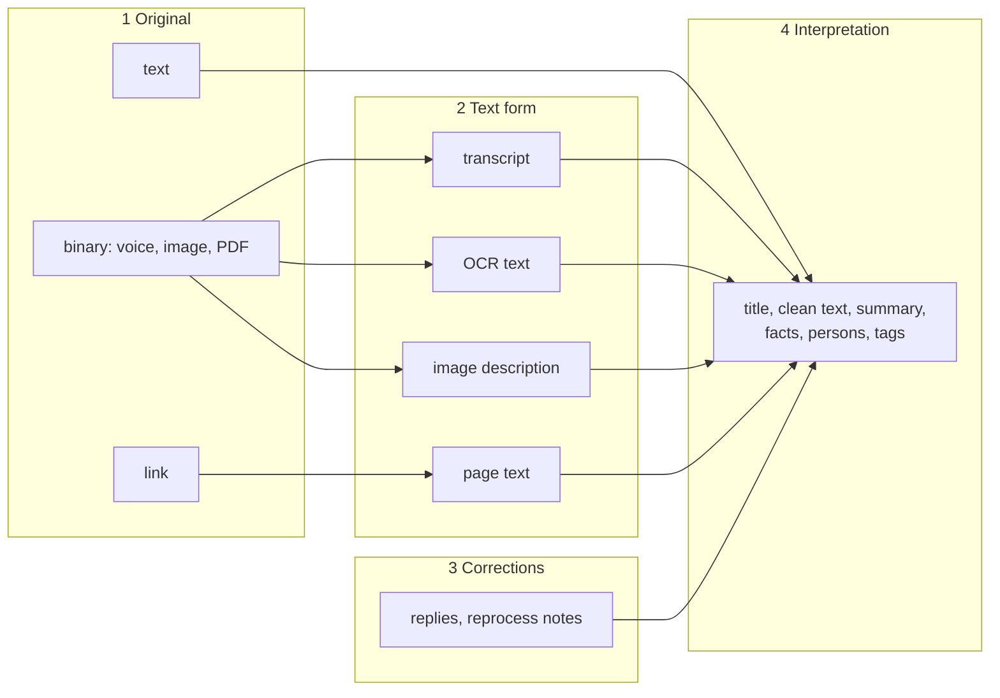
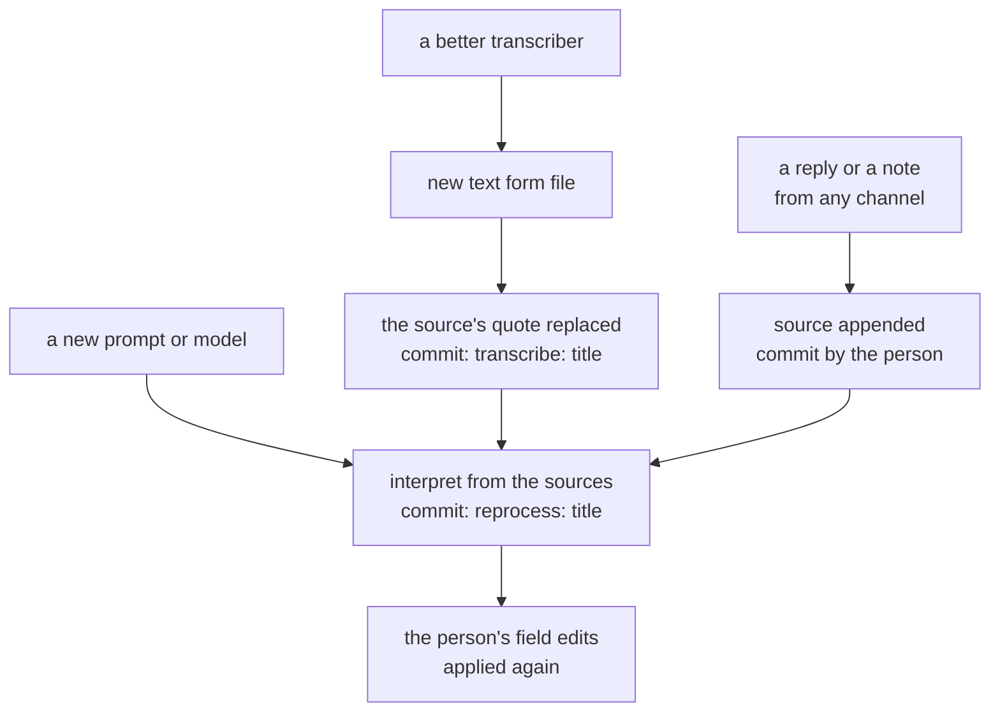

# ADR-018: A Card's Sources

## Status
Accepted, 2026-10-22 (proposed 2026-10-21). Replaces the part of ADR-010
that rebuilds a chat filing from its Matrix message and reply chain, and
ADR-015 §3 (trailers), §5 (how a regenerate keeps a person's change) and
§6 (the diary). Amends ADR-016 §5 (how a correction lands) and ADR-017 §2
and §5 (a record's source ids), §6 (when a note is a record), §9 (who
changes what), §11 (Obsidian, OKF) and §12 (media).

## Context
- **Cards are rebuilt from Matrix, and Matrix is one channel of several.**
  `stack memory capture`, the mail bot, the agent and the card editor write
  cards without a chat message. Old messages in an encrypted room cannot be
  read back later.
- **A card's inputs have five names and no shape.** "Original paste",
  "Caption", "Replies", "Transcript", "Text". Nothing protects them: on the
  test instance a correction wrote prompt text into a note's "Original
  paste" (`note-00c9ff9c9d`), and the next reprocess read it back as the
  person's words.
- **A capture's reprocess reads the card, not its source.** A bookmark is
  rebuilt from its own summary (`capture_pipeline.py`, `reprocess`).
- **The frontmatter mixes two audiences.** A note carries `capture_id`,
  `model`, `timestamp`, `resource` next to `title`, `persons`, `tags`; a
  diary card adds `event_ids`, `media`, `digest`, `duration_ms`, `mode`.
- **Media is tied to Matrix, not to the card.** A card points at
  `/media/2026/10/<event id>.m4a`. The store's sidecar holds the file's
  `sha256`, which no card uses.
- **Transcripts cannot get better.** The transcript cache is keyed by event
  id, records no model and no speakers, and is overwritten.

## Decision

### 1. Four layers between what was sent and the card



| Layer | What | Its words | Its metadata |
|---|---|---|---|
| 1 Original, text | the words as sent | card, `## Sources` | sidecar |
| 1 Original, binary | the file as sent | media store, id `sha256:<hex>` | media store sidecar, card sidecar |
| 2 Text form | a machine's text for a binary or link | media store; copied into `## Sources` where people read it | media store |
| 3 Correction | what a person added later, any channel | card, `## Sources` | sidecar |
| 4 Interpretation | what a prompt made | the rest of the card | sidecar (`made`) |

### 2. The card holds what it is about

```markdown
---
type: note
card_id: note-967b020f7e
title: Lisa's saxophone lesson moved to Thursday
date: "2026-10-22"
persons:
  - lisa
tags:
  - music
---

# Lisa's saxophone lesson moved to Thursday

> **About** [Lisa](../../../../people/lisa.md)

Lisa's saxophone lesson moved to Thursday, 4 pm.
- Price: 30 dollars (raised from 25)
- Pay Mr. Largo in cash.

## Sources

> lisas sax lesson moved to thu 4pm, 25$ pay mr largo cash

> its 30 now, he raised it
```

- **Frontmatter:** `type`, `card_id`, `title`, `kind`, `description`,
  `date`, `persons`, `tags`, and a type's own fields people read
  (`correspondent`, `document_type`, `addressee`).
- **Body:** the title, the meta block (ADR-017 §3), the interpretation,
  then `## Sources`.
- **`## Sources`:** one blockquote per source, in the order of the
  sidecar's `sources`. A binary is embedded inside its quote, followed by
  its text form or caption:

```markdown
## Sources

> ![[/media/2026/10/9ppnpSTkuiY9CsuUNyx73bGrhXcUmddM0KjFbpvpfqE.m4a]]
>
> Hey Bart, the date is March 3rd, 2025. The doctor took the cast off this
> morning. Your arm looks like a noodle and smells worse, but you can climb
> things again. Please don't climb things again.

> "Haybart" is "Hey Bart"
```

### 3. The sidecar holds where it came from and how it was made
`<stem>.json` next to the card, in the same folder:

```
family/itchy-scratchy-land/notes/2026/10/
  lisa-s-saxophone-lesson-rescheduled-to-thursday-7903f2.md
  lisa-s-saxophone-lesson-rescheduled-to-thursday-7903f2.json
```

```json
{
  "card_id": "note-967b020f7e",
  "filed_by": "marge",
  "sources": [
    {"role": "original", "person": "marge", "time": "2026-10-21T08:55+02:00",
     "channel": "chat", "kind": "text", "id": "$Jn4qmFFnVqBMyoUJ3vcmPRc7SoqwUf_uMZfp7zq297M"},
    {"role": "reply", "person": "homer", "time": "2026-10-21T09:10+02:00",
     "channel": "chat", "kind": "text", "id": "$Hk2pQ9xLmW0aZr3T5yUvBn8cDeFgHiJkLmNoPqRsTu"}
  ],
  "made": {
    "at": "2026-10-21T07:12:03Z",
    "model": "Qwen3.6-35B-A3B-UD-MLX-4bit",
    "code_commit": "50efe696",
    "prompt_template": "7c2e91a4",
    "requested_by": "marge"
  }
}
```

A voice diary entry's source, and a document's:

```json
{"role": "original", "person": "homer", "time": "2025-03-03T08:12+01:00",
 "channel": "chat", "kind": "voice", "id": "$9ppnpSTkuiY9CsuUNyx73bGrhXcUmddM0KjFbpvpfqE",
 "media": "sha256:4168fe9973e0031ca1a1b8c445d653bc3f7c56a985eea2093c070ccc5cd8f008",
 "text": {"form": "transcript", "tool": "whisper-large-v3-turbo", "made": "2026-10-08"},
 "duration_ms": 9276, "mode": "monologue", "date_basis": "spoken"}

{"role": "original", "person": "Springfield County Office of Vital Records",
 "time": "2016-04-05T00:00+00:00", "channel": "paperless", "kind": "file",
 "id": "paperless:49", "text": {"form": "ocr", "tool": "paperless", "made": "2026-10-11"}}
```

| Field | Values |
|---|---|
| `role` | `original`, `reply`, `note` (the message given to a reprocess) |
| `person` | a person id, or a correspondent's name |
| `time` | when it was sent, ISO 8601 with offset |
| `channel` | `chat`, `email`, `cli`, `agent`, `cards`, `paperless` |
| `kind` | `text`, `voice`, `image`, `video`, `file`, `link` |
| `id` | the channel's id: a Matrix event id, `message-id`, `paperless:<id>`; generated for `cli`, `agent`, `cards` |
| `media` | `sha256:<hex>` of a binary |
| `text` | which text form the quote shows: `form`, `tool`, `made` |
| `made` | the last interpretation: time, model, `code_commit`, `prompt_template`, who asked |

- **These fields leave the frontmatter:** `capture_id`, `paperless_id`,
  `paperless_url`, `entry_id`, `event_ids`, `timestamp`, `model`,
  `resource`, `media`, `digest`, `filed_by`, `duration_ms`, `mode`,
  `date_basis`, `processing`, `source`.
- **Quote n belongs to `sources[n]`.** The format check reports a
  different count, a card without a sidecar and a sidecar without a card.
- **`prompt_template`** is the hash of the prompt built with fixed placeholders
  for every value that varies per call (date, to-do list, topics, people,
  the text). It changes with the template's wording, not with the day or
  the input; a builder's branches are different templates. A card whose
  `prompt_template` differs from the current code's was made under older
  rules.
- **JSON, not TOML:** the host code is stdlib-only, and Python's stdlib
  reads TOML but cannot write it. The media store's sidecars are JSON too.
- **The cards API indexes the sidecars,** so a lookup by a source id
  (a correction finding its card) does not read every file.
- **Machines write the sidecar:** the pipelines and the card write
  endpoint. People edit the card (§4).
- **A card moved or renamed by hand leaves its sidecar behind:** Obsidian
  and Forgejo move only the file they show. The format check reports the
  sidecar without its card, and the sidecar's `card_id` names the card it
  belongs to.

### 4. Who writes what

| Surface | Reads | Writes |
|---|---|---|
| Obsidian, Forgejo | yes | the card file: a person's edit, as their commit |
| The wiki | yes | no |
| Card browser | yes | through the card write endpoint |
| Chat, email, the agent, `stack memory capture` | | a new card, or a source appended to one |
| Card editor (browser, `stack memory card edit`) | | fields; a `note` source |
| Pipelines (transcribe, interpret, migrations) | | their own layer |

- **People may edit a card by hand,** in Forgejo's editor or in a clone
  opened in Obsidian. The edit is that person's commit (ADR-015 §1, §2),
  and a rebuild reads it from the card's history (§7): a changed field is
  applied again as an operation, a changed clean version goes into the
  card conversation. The card editor writes the same kind of commit,
  `edit: <title>` authored by the person. Neither carries a trailer: the
  diff is the change.
- **No card is frozen, so every record can always be rebuilt.** The diary
  is the one exception until its cards move to sources (Order, step 3): a
  diary card a person corrected or edited is theirs, and the compile
  leaves it alone (ADR-017 §9). Then its `digest` goes.
- **Sources are only appended.** The card write endpoint refuses a change
  to an existing quote or sidecar entry. Only a transcribe step replaces
  the text of its own source's quote.
- **A hand edit of a quote is a correction.** The next rebuild records it
  as a `note` source by the person who made it (what the quote said and
  what they changed it to), and puts the quote back to the words as sent.
- **Card and sidecar change in one commit,** and move together.

### 5. Media: the hash is the id

```
memory/media/2026/10/
  3HFmbGu7….wav                                     the original
  3HFmbGu7….json                                    its sidecar: sha256, mime, size, captured_at
  3HFmbGu7….m4a                                     a playable copy
  3HFmbGu7….transcript.whisper-large-v3-turbo.json  a text form
  3HFmbGu7….transcript.whisper-diarize-v1.json      a newer text form, next to the old one
```

```json
{
  "of": "sha256:4168fe9973e0031ca1a1b8c445d653bc3f7c56a985eea2093c070ccc5cd8f008",
  "form": "transcript",
  "tool": "whisper-large-v3-turbo",
  "made": "2026-10-08T20:46:38Z",
  "language": "en",
  "segments": [
    {"start": 0.0, "end": 4.1, "speaker": "S1",
     "text": "Hey Bart, the date is March 3rd, 2025.", "confidence": 0.91}
  ]
}
```

- A text form is never overwritten; a newer tool writes a new file.
- Speakers are labels. Who `S1` is, is interpretation.
- Transcripts and OCR text are copied into the card's quote: people read
  them. Image descriptions and page text are only referenced in the
  sidecar: they are machine input, often long.
- Media stays out of git (ADR-017 §12). The format check reports a hash
  the store does not have.

### 6. Rebuilding



| Rebuild | Reads | Changes |
|---|---|---|
| Interpret again | `## Sources` and the sidecar (git) | layer 4, `made` |
| Transcribe again | the media store | layer 2, the quote, then layer 4 |

**A card is never rewritten on its own.** A new card is written with the
current prompts. An existing card is rebuilt only when its own sources
changed (a reply, a correction, an edited message, a person's edit), or on
request (`stack memory reprocess`, `stack memory diary --rebuild`). A
prompt change, a new topic or a new person rewrites nothing; the card's
`made.prompt_template` shows which cards older prompts made, and a preview
(`--preview`) shows what a rebuild would change before it runs.

A card nobody corrected or edited is interpreted from its sources alone,
never from its interpretation. A card with corrections or a person's edits
is rebuilt as a card conversation (§7), which starts from its previous
clean version: that is what keeps a person's edit.

**The commit grammar.** Every bot builds its subject from this table
(`stack.card_commits.commit_subject`, which refuses any other prefix), as
its own account with the person as author (ADR-015 §1). The kind is what
a reader takes the commit for.

| Subject | Author | Kind | What happened |
|---|---|---|---|
| `capture: <title>` | the sender | filed | a new card from what somebody sent |
| `learn: <title>` | the sender | filed | a document or a diary entry filed |
| `update: <title>` | the sender | updated | a filing that grew; the diary compile writing entries again |
| `reply: <title>` | the person who replied | replied | a source appended from any channel, and the refile it causes |
| `reprocess: <title>` | the memory bot, or the person whose `--msg` it carries | refiled | an interpret run; `Requested-By:` names who asked |
| `correct: <title>` | the person | corrected | a reply applied to a diary card |
| `edit: <title>` | the person | edited | a change through the card editor |
| `chore(memory): <person> ...` | the person | edited | `stack memory write` |
| `chore(lists): <person> ...` | the person | edited | `stack memory list` |
| `people: ...` | the person, or a bot | edited | the people files |
| `forget: ...` | the memory bot | removed | diary entries deleted in the room |
| `transcribe: <title>` | the memory bot | transcribed | a new text form in a quote |
| `declare: <path>` | the archivist | declared | a correspondent or topic card written once |
| `rename: <from> → <to>` | the archivist | moved | a record moved to where its new class files it |
| `lists: ...` | the person the record is by, or a bot | listed | items put on a list from a record, or archived |
| `cards: ...`, `notes: ...`, `chore(ontology): ...` | a bot | migrated | a migration; `Migration:` names it |
| `seed: ...` | a bot | seeded | a new memory's first content |
| any other subject | a person | changed | a hand edit: Forgejo's editor writes `Update <file>`, a clone what the person typed |

- **A change is the machine's** when its author is a bot or the admin,
  when its kind is `transcribed`, `declared`, `moved`, `listed`,
  `migrated` or `seeded`, or when it is the memory bot's `update:`.
  Otherwise it is the author's.
- **A rebuild keeps a person's commits** of kind `edited`, `corrected` and
  `changed` (§7). `filed`, `updated`, `replied` and `refiled` come from the
  sources.
- **The table is closed.** A new prefix is a change to this table, made
  in the same commit as the writer that uses it.

### 7. Corrections and a person's edits: the card conversation
A card's history is its event log, and the card is its projection. A
person's edit is not stored a second time: it is read from git.

| Event | Where it is read from | How a rebuild applies it |
|---|---|---|
| A correction (chat reply, `--msg`) | `## Sources` and the sidecar | the correction prompt, or a message in the card conversation once a person edited the clean version |
| A person's edit of the clean version | the card's history: the diff of its clean version before and after the person's commit | a message in the card conversation: "Marge edited the card: changed '…' to '…'" |
| A person's field edit (tags, persons, title, date) | the card's history: its frontmatter before and after the person's commit | an operation applied in code after the model: `add`/`remove` for a list, `set`/`unset` for a value |

- **Whose commit counts** is decided by the one rule the dashboard and
  `stack memory history` use (§6, `stack.card_commits.is_machine`): a
  person's change, not a bot's own rebuild, a migration or a plain
  reprocess.
- **Two prompts, chosen by what the card has.** A note with chat
  corrections and no person's text edit is rebuilt with the dedicated
  correction prompt (24 of 24 on `tests/e2e/eval/correction_fold.py`,
  where the conversation reached 21: it dropped the second point of a
  correction that made two). A note whose clean version a person edited is
  rebuilt as the card conversation. Field edits are applied as operations
  either way.
- **The card conversation:** a system message with the task (the card as it
  should read now; later events win; nothing added, nothing dropped), the
  original words, the previous clean version as the model's answer, then
  one message per correction or edit in time order, then the request for
  the card now. Measured on the instance's model: 24 of 24 edits kept,
  against 15 to 21 for the same events as a list or as raw diffs, and 2 of
  8 for a deterministic `git apply` after a rebuild
  (`tests/e2e/eval/edit_replay.py`).
- **Field operations** are derived from the frontmatter difference (set
  difference for lists, so the model's other suggestions still come in) and
  applied in order; one that no longer fits the schema (a topic id a
  migration renamed) is left out and named, never silently.
- **The check after the model** is the one rule of the first filing (§2):
  every number and name of the original words is in the clean version. A
  value a correction or an edit replaced is no longer required. Beyond that
  a rebuild with corrections is not refused for wording; the benchmark, not
  a stricter rule, watches its quality.
- **Conditions:** full history wherever a rebuild runs (no shallow clone),
  a card's history follows a move by its `card_id`, and the cost is one
  `git log` of the card per rebuild.
- **The price:** a card with edits re-derives less after a prompt or model
  change, because it starts from its previous clean version.

### 8. What Matrix is for
- **A channel:** filing reads a message once, while it can be decrypted.
- **Coordination between the bots** (`dev.famstack.event`).
- **Not a source for rebuilding.** The diary follows the rule of every
  record: its compile files new messages into sources, and a reply in a
  card's thread is a `reply` source. The diary exception in
  `docs/agent/dev.md` goes with Order step 3.
- **A bridge for notes filed before their sidecar.** Until the first
  release after 0.5, a refile of a note also reads its Matrix thread where
  the bot runner can: a reply the old card never held is appended as a
  `reply` source, and a source the migration could only reconstruct is
  read again from its message. Notes filed since hold every reply as a
  source when it arrives, so the thread adds nothing for them. After that
  release a refile reads the card and its sidecar only, and a
  reconstructed source stays as it is.

## Order
1. Notes (`feat/note-clean-pass`): the clean pass writes the card and its
   sidecar; reprocess reads the sources; a migration converts existing
   notes. Done 2026-10-22 for the notes the archivist files; `stack memory
   write` writes no sidecar yet.
2. The card write endpoint refuses changes to existing sources.
3. The diary: sources and replies as sources; `digest` dropped.
4. Documents, bookmarks, email.
5. Media by hash; the transcript cache becomes text form files.
6. `stack memory transcribe <card_id>`, then a transcriber that tells
   speakers apart.

Each step moves one card type's writer, readers and migration together.
A migration converts the old sections into quotes and moves the fields
into the sidecar, without model calls:

| Today | Becomes |
|---|---|
| note: "Original paste" | quote; `original`, from `filed_by`, `timestamp`, `capture_id` |
| note: "Caption" and image | quote with the embed; `original`, `kind: image`, `media` |
| note: "Replies" | quotes; `reply`, `time` and `id` `unknown` |
| diary: "Transcript", "Text" | quotes; `original`, from `event_ids`; `media` from the store's sidecar |
| document: the OCR text | quote; `original`, `paperless:<id>` |
| bookmark: `resource` only | quote with the URL; `original`, `"reconstructed": true` |
| a quote holding prompt text | kept, `"reconstructed": true`, reported |

## Verification
- **Rebuild test** (ADR-010): fabricated sources filed; layer 4 removed;
  interpreted again; `## Sources` and `sources` unchanged byte for byte.
- **Format check:** every record has a sidecar; quotes and `sources` have
  the same count; every `media` hash exists in the store; no machine field
  is left in the frontmatter.
- **Endpoint:** a change to an existing quote or source is refused; an
  appended `note` is accepted, as one commit for card and sidecar.
- **A hand edit:** a person edits a note, then somebody replies to it in
  the chat; the refile and a reprocess preview both keep the edit. Passed
  on the test instance 2026-10-22 (`note-ddb0d9625a`).
- **A quote edited by hand:** the refile puts the quote back and appends a
  `note` source by the person who edited it.
- **A second transcript:** the old text form file stays; only the quote and
  layer 4 change.
- **Readers:** the wiki and the card browser show no `.json` file as a
  page.

## Consequences
- A card reads as what it is about. Its origin is one file away.
- A card can be rebuilt from git alone, except where a text form is only
  referenced or a binary must be transcribed again.
- Every record can always be rebuilt; no card is frozen once the diary
  has moved (Order, step 3).
- People keep editing cards where they read them, and a rebuild keeps
  what they changed.
- Matrix history can be lost without losing the memory.
- Two files per record. Every record changes shape once, one migration
  commit per card type.

## Considered
- **Source details in the card body,** as a heading per quote
  (`marge · 2026-10-21T08:55+02:00 · chat · text · original · $Jn4qm…`) or
  in an HTML comment. Technical text in a page meant for people.
- **Source ids in the frontmatter** (`source_ids`). Fits ADR-017 §8 but
  leaves the rest in the body and keeps the frontmatter technical.
- **Nobody edits a card by hand** (this ADR as first merged). People do,
  in Forgejo and Obsidian (ADR-015, ADR-017 §1); forbidding it would only
  hide their edits from a rebuild.
- **Sidecars in a separate folder** keyed by `card_id`. A card moved by
  hand would keep its sidecar, at the price of a second tree nobody moving
  files sees. The sidecar's `card_id` finds its card instead (§3).
- **Matrix as the source** (ADR-010 as written). Fails for channels without
  a chat message and for encrypted history, and ties the memory to Synapse.
- **Git as the evolution:** provenance as commit trailers on every step, a
  preview as a branch, apply as a merge, batches and benchmarks as
  branches. Needs branches, merges and an index over the history.
- **Media in git (LFS).** Every clone large (ADR-017 §12).
- **Keep every intermediate.** Only text forms of binaries and links are
  kept. A prompt is recorded by its template's fingerprint; the template is in the commit
  `code_commit` names.

## Open
- **Forgetting.** A source that must go: its quote and sidecar entry
  removed in a commit, its binary and text forms deleted. Whether the
  memory repo's history is then rewritten on Forgejo, and by whom.
- **Speaker names.** Whether `S1 is Marge` is a `reply` source or a field.
- **A stranded sidecar** (§3): whether the format check moves it next to
  its card, or the next write of the card does. Until then a person moves
  it.
