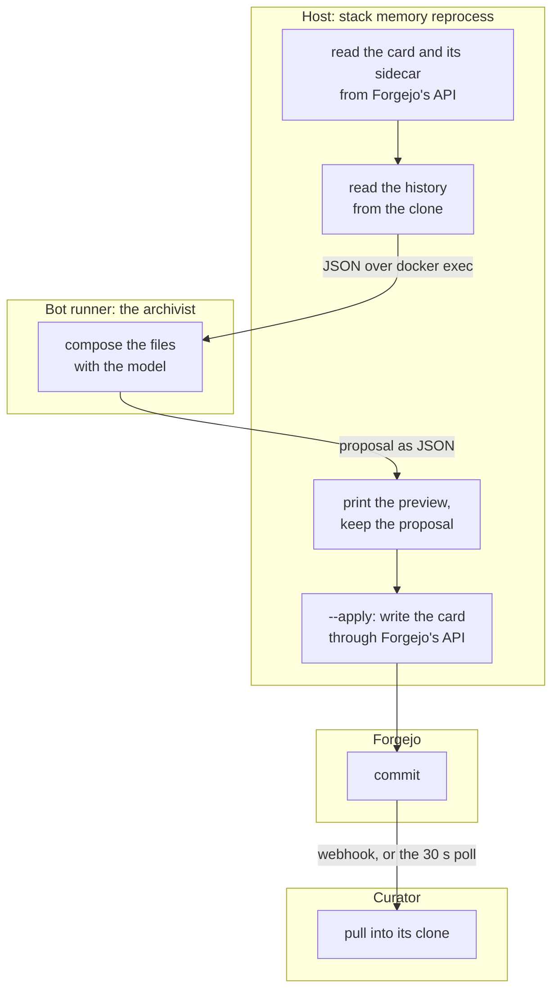
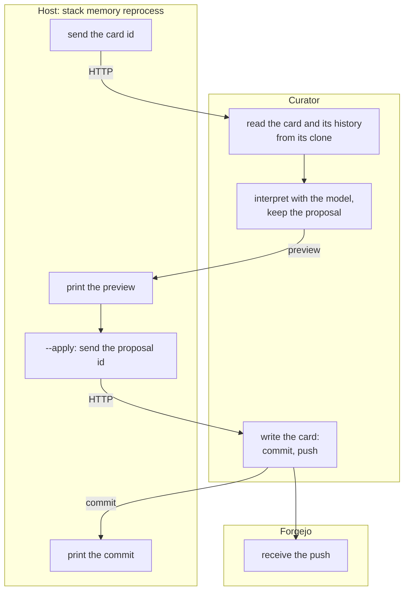
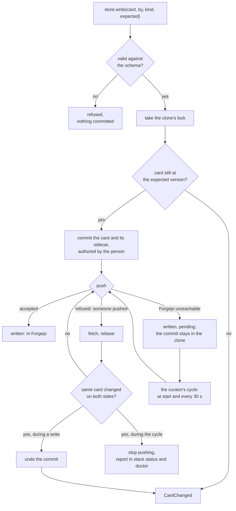

# ADR-019: Where Code Runs, and the Check That Keeps It There

## Status
Accepted, 2026-10-23.

- **Amends** dev.md invariant 5 (the CLI is the agent's interface): the
  CLI stays that interface, and becomes a client of the stacklet that owns
  the logic.
- **Keeps** dev.md invariant 2 (the host CLI is stdlib-only). Host code
  that holds only the command line needs no packages, so uv on the host
  waits.
- **Replaces** gathering the card base in the framework (`lib/stack/cards`,
  cdcf8832): card code moves into the memory stacklet over time.
- **Replaces, step by step,** the bot runner's role as the tools runtime
  for host commands (`lib/stack/bot_runner.py`).

## Update, 2026-10-25
What landed on `feature/0.5.0-beta.1`, and what that answers.

- **The memory has one writer (§3, §4, steps 2 and 3 for the writers),
  #325.** The archivist, the diary, the host commands, the card editor and
  the migrations write through the curator's API into its card store; a
  change made while Forgejo is down is kept in the curator's clone and
  pushed when Forgejo answers. This was the first feature, and the card
  store is in 0.5 (both questions under Open).
- **A stacklet is a package, #327.** A stacklet's code is the package
  `stacklets.<id>` (`stack.stacklet_code`): its commands, hooks, migrations
  and bots are modules of it, import each other relatively, and one file
  is one module. A process entry point registers the stacklets once
  (`import_stacklets`); nothing below it edits `sys.path`. R2 counts an
  import of `stacklets.<b>` as it counts one of `<b>`.
- **The baseline went from 151 entries to 81.** What is left: R1 in
  memory (58: host code that imports a domain unit of `lib/stack` or
  memory's service code), R2 from docs into memory (12) and from backup
  into messages (1), R6 in backup (8), one each of R4 and R5.

## Context
- **One operation runs in two places.**
  - `stack memory reprocess` reads a note's history on the host, sends it
    as JSON to the archivist in the bot runner, gets a proposal back and
    writes from the host.
  - `stack memory search` rewrites the keywords in the bot runner and
    searches the files on the host.
  - `stack memory write` runs the archivist's capture command and reads
    the result back from its printed receipt with regexes.
  - The chat refiles a note with the same logic entirely inside the bot
    runner, with a second history reader.
- **Cards are written over HTTP from many places.** 13 places in 6 files
  write the memory repository through Forgejo's API (`memory/lib.py`,
  `card_write.py`, `card_edit.py`, `cli/ontology.py`, `bot/cli/lists.py`,
  `bot/cli/diary.py`). History is read from the clone on the host and from
  Forgejo's API in the bot runner: 44 requests for a card with 20 versions
  and one move (`lib/stack/cards/history.py:413`).
- **The framework holds the product.** 11,367 of the 20,065 lines in
  `lib/stack` are famstack's domain or the container runtime: cards,
  lists, people, tags, ontology, media, mail, Matrix, AI, web.
- **Stacklets reach into each other.**
  - The docs stacklet imports memory code 15 times in 10 files.
  - The `docker exec` dispatcher exists in four copies.
  - There are 109 `sys.path` edits outside the tests, so no tool can
    follow the imports.
- **Cards are hard to test.** Because they are written through Forgejo's
  API, card writes and history are tested against a real Forgejo
  container.

## Decision

### 1. Three kinds of code, each in one place

| Kind | Runs | Holds | Never holds |
|---|---|---|---|
| **CLI** | the host, `./stack` | parsing arguments, printing, the lifecycle (compose, hooks, launchd, secrets, config, update, doctor), and for each stacklet a client of its service | domain logic, file formats, model calls, reading a stacklet's data |
| **Service** | the stacklet's own container | the stacklet's domain: its data, its formats, its model calls, its API | another stacklet's code |
| **Framework library** | wherever it is imported | generic, stacklet-agnostic code: config, output, the bot runtime (Matrix, the AI client) | anything famstack-specific |

Hooks stay lifecycle: they create directories, start services and write
tokens. A data migration belongs to the stacklet's service.

### 2. One operation, one place
- **A stacklet's domain is reached only through its API.** HTTP between
  services, Matrix events between bots, the CLI for people and the agent.
- **A CLI command is a client.** It sends one request to the owning
  service and prints the answer. It never does half the work.
- **The curator owns the memory's clone and every write to it.** Filing,
  search and the wiki builds move into it when a change touches them. The
  archivist owns Paperless and Matrix.

`stack memory reprocess` today: the host reads, the bot runner composes,
the host writes, and the curator learns about it from Forgejo.



The same command once filing has moved: the host sends two requests and
prints two answers, and everything between them happens in the curator.



### 3. Cards: a local git store in the curator
`stacklets/memory/cards/`. The format modules in `lib/stack/cards` move
into it when a change touches them. A sketch, not a final API:

```python
from stacklets.memory.cards import CardStore, Person, CardChanged

store = CardStore(Path("/data/memory/vault"))   # the curator's clone

card = store.get("note-3f2a1b9c0d")             # Card; CardNotFound, or CardRemoved with the commit
card.fields, card.body, card.sources, card.path, card.version

store.find(type="note", tag="camping", person="homer")

store.write(card.with_fields(tags=[...]), by=Person("marge"), kind="edit",
            expected=card.version)              # card and sidecar, one commit, pushed; CardChanged if it moved on
store.commit([Write(a), Move(b, to=...), Remove(c)], by=..., kind="rename")   # several cards, one commit

store.history("note-3f2a1b9c0d")                # versions, followed across moves by card_id
store.pending()                                 # commits Forgejo does not have yet
```

- **Native git, Forgejo as the remote.** Forgejo is where the family edits
  by hand and where the clone pushes. Its API is used for setup only: the
  repository, users, tokens and the push webhook. Any git server would do.
- **No storage abstraction.** A writer still on Forgejo's API is, to the
  clone, another person pushing: the next pull merges it. Old writers move
  to the store one at a time, and nothing has to hide which path a write
  took.
- **The store makes the commit.** The subject comes from the kind, through
  one table of origins, the author from the person, and the committer is
  the memory bot. A caller never builds a commit message.
- **The store checks every write against the JSON Schemas** with
  jsonschema, the one schema engine. Three readers check schemas today.
- **History has one reader:** `git log --follow` in the clone.
- **Other containers and the host use the curator's HTTP endpoints,** the
  way the host already writes cards (`stacklets/memory/card_schema.py:40`).
- **It is not slower.** Measured on made-up data (1,500 cards with
  sidecars, 335 commits, git 2.46, a local bare repository as the remote):
  a commit of a card and its sidecar takes 35 ms, a push 65 ms, a fetch
  with nothing new 29 ms, the history of a card with 20 versions and a
  move 64 ms. A push to Forgejo adds HTTP, sign-in and Forgejo's checks on
  receive, which were not measured.

### 4. Every write reaches the remote



1. **A write pushes before it answers.** Normally "written" means "in
   Forgejo".
2. **A refused push is rebased, never forced.** When someone edited in
   Forgejo meanwhile, the curator fetches, rebases and pushes again. When
   both sides changed the same card, it undoes its own commit and the
   caller gets `CardChanged`.
3. **An unreachable Forgejo does not lose a write.** The commit stays in
   the clone on the data disk and the curator pushes it at start and every
   cycle (30 s), as it already does for the wiki's repository
   (`stacklets/memory/bot/curator.py:1077`). Writes and the curator's pull
   hold one lock, as the wiki's repository does (`curator.py:1053`).
4. **A delay is visible.** `stack status` and `stack doctor` show the
   commits Forgejo does not have yet and the oldest one's time. A conflict
   found on a later retry stops the pushing and is reported there, never
   resolved by force.
5. **The clone is backed up.** A commit that waits for Forgejo exists
   only in the clone, so a backup of Forgejo alone would miss it. The
   clone gets a `[[backup.snapshot]]` of kind `git`: a dated git bundle
   of every ref, written only when the refs changed. An archive cannot
   hold the clone, because its files change and the backup engine never
   overwrites a file.
6. **A module test pins it without a container.** A bare repository
   refuses pushes through a `pre-receive` hook: the write succeeds and one
   change is pending. Without the hook, the next cycle pushes it. A second
   clone stands in for Marge editing in Forgejo, for the rebase and
   `CardChanged`.

### 5. A package: one public surface, tested from outside
- **One public surface.** A package exposes its API in `__init__.py`; its
  other modules start with `_`. Other packages and the tests import the
  public surface only.
- **I/O in named adapters** (`_git.py`, `_model.py`). The rest of the
  package is pure.
- **Tests drive the public API** with real local collaborators: a git
  repository in a temp directory, not a container. A module test reads
  like the API's documentation (AGENTS.md §6).

### 6. The rules, checked on every commit

| # | Rule | How the check sees it |
|---|---|---|
| R1 | Host code imports no domain and no service code. | A file the policy places on the host (`stacklets/*/cli/`, `hooks/`, `migrations/` and the listed host services) imports a domain unit of `lib/stack` or its stacklet's service code. |
| R2 | No stacklet imports another stacklet's code. | An import in `stacklets/a/` that resolves into `stacklets/b/`, by package name or through `sys.path`. |
| R3 | The framework imports no stacklet and no famstack domain. | An import from `lib/stack/` into `stacklets/`, or from a framework unit into a domain unit. Every unit of `lib/stack` is placed as one or the other. |
| R4 | In a listed package, only adapter modules do I/O. | `subprocess`, `socket`, `urllib.request`, `httpx` and the like imported outside the adapters, in the packages the policy lists (cards first). |
| R5 | A private module is imported only from its own directory. | An import of a module whose name starts with `_` from another directory. |
| R6 | No `sys.path` edits outside entrypoints. | `sys.path.insert`, `append`, `extend` or an assignment outside the listed entrypoints (the bot runner's main, the CLI entrypoints, the service mains). |

- **`tools/arch-check`** reads each file with `ast`, places it by its path
  (CLI, a stacklet's service, the framework) and resolves each import by
  name. The placement is in `tools/arch-check.toml`. It runs in `make lint`
  and in CI.
- **It ratchets.** The 157 violations it found on its first run are listed
  in `tools/arch-baseline.toml`. CI fails on a new violation, and also on
  a baseline entry that no longer occurs, so the list only shrinks.
- **The bot runtime is the one exception.** `MicroBot` lives in
  `stacklets/core/bot-runner/`, and every bot imports it. The check treats
  it as framework until it moves into `lib/stack`.
- **The check sees imports, not intent.** A feature inside the curator
  could still call an old Forgejo writer. Review catches that.
- **Why not import-linter:** it needs every file inside an importable
  package. The stacklets are packages since 2026-10-25 (see Update), but
  not every file has an importable name: core's `bot-runner/` and
  `tools-server/`, `check-format.py`, backup's `engines/external-disk`. It
  can replace the tool once they do.

### 7. Order
Rules now; code moves when a feature touches it.

1. **Now:** this ADR, and `tools/arch-check` with the violations of today
   as its baseline. No behaviour change.
2. **With the first feature that writes cards:** the card store in the
   curator with §4, and the card write endpoint moved onto it.
3. **When a feature touches them:** the other writers, the filing API
   (filing is split across stacklets and processes today), search, and the
   memory CLI commands as clients.
4. **Later:** famstack's code out of `lib/stack`. uv on the host only if
   host code ever needs packages. Cards into core only if a stacklet needs
   them without memory installed.

## Consequences
- **Gains:**
  - An operation runs in one place, so a fix is made once.
  - Cards are tested with a temp git repository, without Docker.
  - Writes survive a restart of the code stacklet.
  - The check keeps the boundaries without anyone having to remember
    them.
- **Old and new paths coexist** while writers move. The baseline shows
  what is left.
- **dev.md changes:** invariant 5 now, the architecture check with the
  check, the testing section with the card store.
- **The agent takes two hops:** the host API server runs a CLI client,
  which calls the service. Calling the services directly is a later step.

## Open
- **The first feature:** which one, and whether it touches filing
  (capture, reprocess, refiling). If it does, step 3's filing API cannot
  wait.
- **0.5:** the check goes into 0.5. Whether the card store does depends on
  the first feature.
