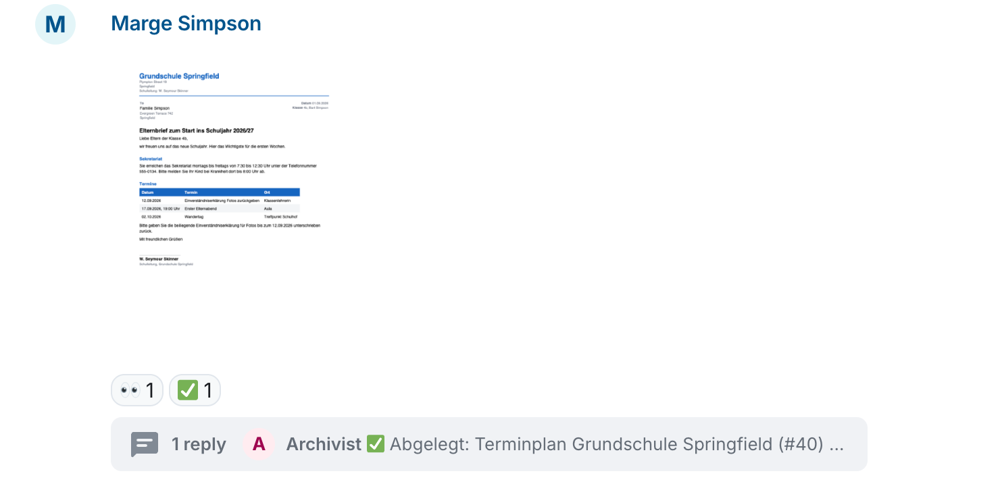
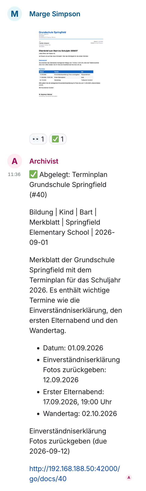
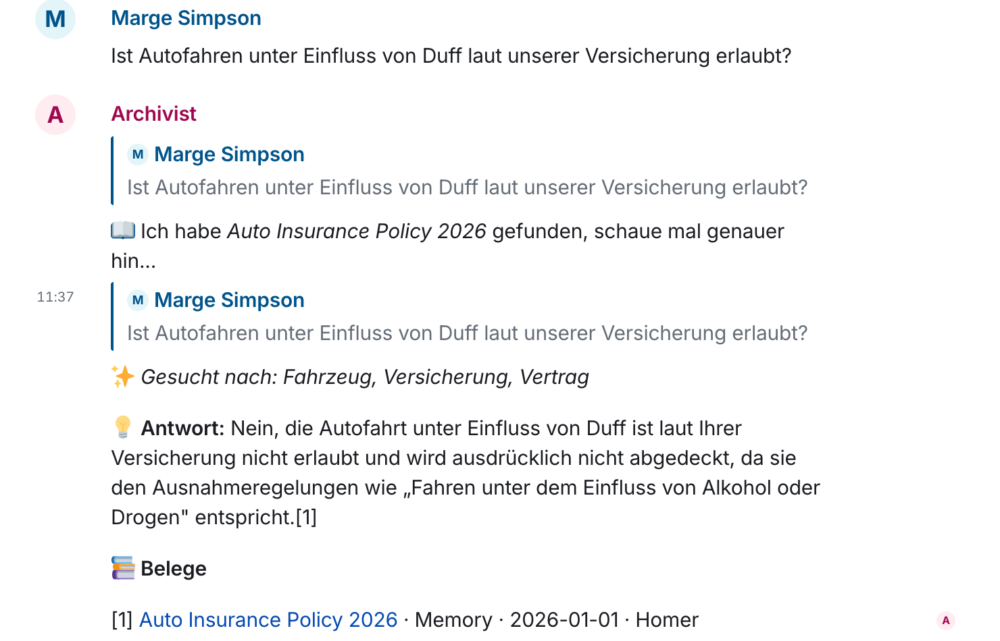

# Dokumentenverwaltung mit lokaler KI: per Chat ablegen, später fragen

Stell dir vor, du machst einfach ein Foto von einem Dokument und schickst es in
deinen privaten Messenger, wie WhatsApp, aber lokal. Den Rest macht dein Mac: Er
liest den Text, erkennt, worum es geht und für wen das Dokument ist, und legt es
sauber ab. Und wenn du es in einem halben Jahr wieder brauchst, fragst du einfach.

famstack ist eine selbst gehostete Dokumentenverwaltung für die Familie, die du
über den Chat bedienst. Du fotografierst ein Dokument und schickst es in den
Documents Room. Der Archivist, der Ablage-Bot von famstack, erkennt den Text
(OCR), legt das Dokument in einem Paperless-ngx-Archiv auf deinem Mac ab und
antwortet mit dem, was er gefunden hat: ein Titel, für wen es ist, wer es
geschickt hat, Beträge und Termine, und was du tun sollst. Monate später fragst
du im Chat und bekommst die Antwort, mit dem Dokument, aus dem sie stammt.
Standardmäßig läuft das auf dem Mac zu Hause, mit lokaler KI und ohne
Cloud-Konto.

> Braucht das Stacklet `docs`. Lesen und Ablegen mit KI braucht `ai`. Listen
> und Termine brauchen `memory`, Antworten mit Quellen zusätzlich `code`, denn
> dort liegt das Familiengedächtnis.

## 1. Post ist da

Der Elternbrief zum neuen Schuljahr, die Beitragsrechnung der Kfz-Versicherung,
der Steuerbescheid, die Rechnung vom Zahnarzt. Das meiste liest du einmal und
brauchst es Monate später wieder, meistens in Eile: die Nummer vom
Schulsekretariat, wenn das Kind krank ist, die Versicherungsnummer, wenn die
Scheibe gesprungen ist.

## 2. Foto machen und in den Chat schicken

Mit dem Handy fotografieren oder das PDF weiterleiten und in den **Documents
Room** schicken. Fertig.

- **Eine Bildunterschrift hilft.** „Das ist für die Steuer“, und der Archivist
  berücksichtigt das beim Ablegen.
- **Mehrere Seiten:** `(` tippen, die Seiten nacheinander schicken, dann `)`.
  Daraus wird ein Dokument.
- **Fotos und Scans liest der Mac selbst** (OCR). PDFs mit Textebene übernimmt
  er direkt.

## 3. Der Archivist legt es ab

Der Archivist setzt 👀 auf deine Nachricht, solange er liest, ✅, wenn er fertig
ist, und antwortet im Thread darunter:

> ✅ Abgelegt: Terminplan Grundschule Springfield (#40)
>
> Bildung | Kind | Bart | Merkblatt | Springfield Elementary School | 2026-09-01
>
> Merkblatt der Grundschule Springfield mit dem Terminplan für das Schuljahr
> 2026. Es enthält wichtige Termine wie die Einverständniserklärung, den ersten
> Elternabend und den Wandertag.
>
> - Einverständniserklärung Fotos zurückgeben: 12.09.2026
> - Erster Elternabend: 17.09.2026, 19:00 Uhr
> - Wandertag: 02.10.2026
>
> Einverständniserklärung Fotos zurückgeben (due 2026-09-12)
>
> http://192.168.188.50:42000/go/docs/40

Von oben nach unten: der Titel und die Nummer des Dokuments, dann Thema,
Familienmitglied, Dokumentart, Absender und Datum. Darunter eine kurze
Zusammenfassung, die Fakten, die du später wiederfinden willst, was der Brief von
dir will, und ein Link zum Dokument im Archiv.

Mit so einem Brief macht der Archivist noch zwei Dinge:

- **Aufgaben kommen auf eine Liste.** Die Einverständniserklärung landet auf der
  Liste zum Thema des Briefs, mit der Frist und einem Link zurück zum Brief.
  Abhaken kannst du sie bei [Stacky](../../user-guide.md#lists) wie alles andere.
- **Termine kommen in den Kalender.** Der Elternabend kommt auf die
  Kalenderliste der Familie, mit dem Kind, um das es geht. Gibt es noch keine,
  legt der Archivist eine an: Termine.

**Auf Deutsch, durchgehend.** Ist Deutsch die Sprache deiner Familie, schreibt
der Archivist Titel, Zusammenfassung und Fakten auf Deutsch, egal in welcher
Sprache der Brief ist. Die spanische Hotelrechnung aus dem Urlaub bekommt eine
deutsche Zusammenfassung. Namen, Beträge und Fachbegriffe bleiben, wie sie sind,
das Original bleibt unverändert. Auch die Themen, nach denen er ablegt, sind
deutsch: Versicherung, Steuer, Finanzamt, Bildung, Gesundheit, Wohnen,
Nebenkosten und so weiter.

**Etwas falsch?** Antworte im Thread: „Das ist für Lisa, nicht für Bart.“ Der
Archivist liest den Brief mit deiner Korrektur noch einmal und legt ihn neu ab.
Mehr unter [Fehler der Bots korrigieren](../../user-guide.md#correct-bot-mistakes).

## 4. Und dann vergessen

Keine Ordner, nichts zu sortieren. Das Original und der Text, den die OCR
erkannt hat, bleiben im Archiv auf dem Mac. Paperless-ngx hat eine eigene
Weboberfläche, falls du stöbern willst, aber du musst sie nicht öffnen.

## 5. Monate später fragen

Im Documents Room tippst du ein Suchwort oder stellst eine Frage:

> **Marge**: Ist Autofahren unter Einfluss von Duff laut unserer Versicherung erlaubt?
>
> **archivist**: Nein, die Autofahrt unter Einfluss von Duff ist laut Ihrer
> Versicherung nicht erlaubt und wird ausdrücklich nicht abgedeckt, da sie den
> Ausnahmeregelungen wie „Fahren unter dem Einfluss von Alkohol oder Drogen"
> entspricht. [1]

Die Police wurde Monate vorher abgelegt. Der Archivist hat sie gefunden,
vollständig gelesen und die Klausel genannt, mit dem Dokument als Quelle.

Ein, zwei Wörter (`Versicherung`, `Impfung Bart`) zeigen die passenden
Dokumente. Alles mit Fragezeichen bekommt eine Antwort: Der Archivist durchsucht
das Archiv und das Familiengedächtnis, liest, was er findet, und antwortet mit
nummerierten Quellen zum Nachprüfen. `show 57` holt das Dokument selbst in den
Chat.

In jedem anderen Raum sprichst du ihn mit Namen an: „Archivist, wann verlängert
sich die Autoversicherung?“ Mehr unter [Fragen stellen](../../user-guide.md#ask-questions).

## 6. Je mehr du ablegst, desto wertvoller wird es

Ein abgelegtes Dokument hilft dir weiter. Seine Fakten kommen ins
Familiengedächtnis, famstack macht daraus im Familien-Wiki eine Seite für jede
Person und jedes Thema, und beim nächsten Schreiben von der Schule, der
Versicherung oder der Hausarztpraxis erkennt der Archivist den Absender wieder,
auch wenn der Name anders geschrieben ist. So landet alles unter dem richtigen
Namen, und jede Antwort kann auf mehr zurückgreifen.

## Wo deine Dokumente liegen

| Was | Wo |
|---|---|
| Die Originale und ihr Text | Paperless-ngx, im Stack auf deinem Mac |
| Was der Archivist gelernt hat: Fakten, Aufgaben, Termine | das Familiengedächtnis, einfache Markdown-Dateien auf dem Mac |
| Die KI, die sie liest | standardmäßig ein lokales Modell auf der GPU des Macs (oMLX) |

Du kannst die KI auf einen anderen Rechner im Haus oder einen externen Anbieter
umstellen. Dann geht der Text der Dokumente zum Lesen dorthin; das Archiv bleibt
auf dem Mac.

## Was du brauchst

Einen Mac mit Apple Silicon, für deutsche Dokumente mit 32 GB. Damit läuft das
größere Qwen3.6-35B-A3B, das in jeder Sprache besser ablegt und für Deutsch die
richtige Wahl ist. 16 GB reichen für Qwen3.5-9B: Englisch klappt gut, Deutsch ist
bei langen, förmlichen Briefen spürbar schwächer. Die Einrichtung steht im
[Admin-Handbuch](../../admin-guide.md#install).

## Häufige Fragen

### Ist famstack eine Alternative zu Paperless-ngx?

famstack baut auf Paperless-ngx auf und ersetzt es nicht. Paperless-ngx ist das
Archiv mit Texterkennung und Volltextsuche. famstack installiert es auf deinem
Mac und setzt den Chat und den Archivist davor: Ablegen per Foto, Thema und
Person per lokaler KI, Antworten auf Fragen mit Quellen.

### Brauche ich dafür eine Cloud?

Nein. Archiv, Texterkennung und KI laufen standardmäßig auf deinem Mac. Nur wenn
du die KI auf einen externen Anbieter umstellst, geht der Text der Dokumente
dorthin.

### Funktioniert das mit deutschen Dokumenten?

Ja. Themen, Titel, Zusammenfassungen und Fakten sind auf Deutsch, wenn Deutsch
die Sprache deiner Familie ist, auch bei Dokumenten in anderen Sprachen. Für
gute Ergebnisse auf Deutsch empfehlen wir 32 GB.

## Siehe auch

- [Alles sichern: Capture Rooms](../../user-guide.md#save-anything-capture-rooms): Links, Notizen
  und Fotos, die keine Dokumente sind
- [E-Mail](../../user-guide.md#email): ablegen, was per Mail kommt
- [Listen](../../user-guide.md#lists): was mit den Aufgaben passiert
