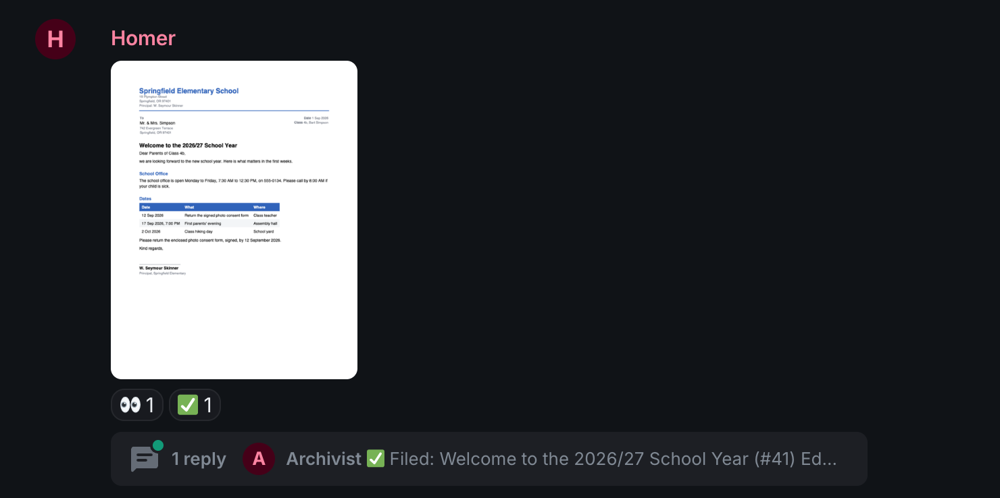
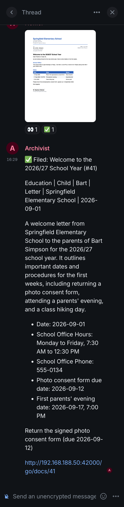
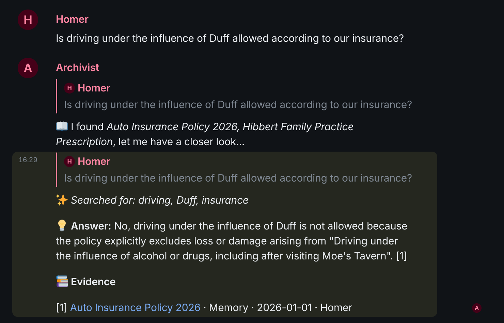

# Documents: file it from the chat, ask for it later

Imagine you take a photo of a document and send it to your private messenger,
like WhatsApp, but local. Your Mac does the rest: it reads the text, works out
what the document is about and who it is for, and files it. When you need it
again half a year later, you just ask.

famstack files your household's paperwork from the family chat. You photograph
a document and send it to the Documents Room. The archivist, famstack's filing
bot, reads it, files it in a Paperless-ngx archive on your Mac and replies with
what it found: a title, who it concerns, who sent it, the amounts and dates, and
anything it asks you to do. Months later you ask in the chat and get the
answer, with the document it came from. It runs on the Mac at home by default,
no cloud account needed.

> Needs the `docs` stacklet. Reading and filing with AI needs `ai`. Lists and
> dates need `memory`, and answers with sources need `code` too, because it
> holds the family memory.

## 1. A letter arrives

The school's letter for the new year, the car insurance renewal, the tax
office, the doctor's invoice. Most of it you read once and need again months
later, often in a hurry: the school's phone number on a sick day, the policy
number after a cracked windscreen.

## 2. Take a photo and send it to the chat

Photograph it with your phone, or forward the PDF, and send it to the
**Documents Room**. That's it.

- **A caption helps.** "This is for the tax file" and the archivist takes it
  into account when filing.
- **Several pages:** type `(`, send the pages one by one, then type `)`. They
  become one document.
- **Photos and scans are read on the Mac** (OCR). PDFs that already contain
  text are used directly.

## 3. The archivist files it

The archivist puts 👀 on your upload while it reads, ✅ when it's done, and
answers in the thread under your upload:

> ✅ Filed: Welcome to the 2026/27 School Year (#41)
>
> Education | Child | Bart | Letter | Springfield Elementary School | 2026-09-01
>
> A welcome letter from Springfield Elementary School to the parents of Bart
> Simpson for the 2026/27 school year. It outlines important dates and
> procedures for the first weeks, including returning a photo consent form,
> attending a parents' evening, and a class hiking day.
>
> - Date: 2026-09-01
> - School Office Hours: Monday to Friday, 7:30 AM to 12:30 PM
> - School Office Phone: 555-0134
> - Photo consent form due date: 2026-09-12
> - First parents' evening date: 2026-09-17, 7:00 PM
>
> Return the signed photo consent form (due 2026-09-12)
>
> http://192.168.188.50:42000/go/docs/41

From the top: the title and the document's number, then the topic, the family
member, the type of document, who sent it and its date. Below that a short
summary, the facts worth finding again, what the letter asks you to do, and a
link to the document in the archive.

The archivist does two more things with a letter like this one:

- **To-dos go on a list.** The consent form lands on the list of the letter's
  topic, with its due date and a link back to the letter. Tick it off with
  [Stacky](../user-guide.md#lists) like anything else.
- **Dates go on the calendar.** The parents' evening goes on the family's
  calendar list, with the child it names. Without a calendar list yet, the
  archivist starts one called Dates.

**In your family's language.** The title, summary and facts are written in the
family's language, whatever language the letter is in. A Spanish hotel bill gets
a German summary in a German family. Names, amounts and technical terms stay as
they are, and the original stays untouched.

**Something wrong?** Reply in the thread: "this is Lisa's, not Bart's". The
archivist reads the letter again with your correction and files it again. See
[Correct bot mistakes](../user-guide.md#correct-bot-mistakes).

## 4. Forget about it

There are no folders to sort. The original and the text the OCR found stay in
the archive on the Mac. Paperless-ngx has its own web interface if you want to
browse, but you don't have to open it.

## 5. Ask months later

In the Documents Room, type a word to search, or ask a question:

> **Homer**: Is driving under the influence of Duff allowed according to our insurance?
>
> **archivist**: No, driving under the influence of Duff is not allowed because
> the policy explicitly excludes loss or damage arising from "Driving under the
> influence of alcohol or drugs, including after visiting Moe's Tavern". [1]

The policy was filed months earlier. The archivist found it, read it in full and
quoted the clause, with the document as the source.

A word or two (`insurance`, `vaccination Bart`) lists the matching documents.
Anything with a question mark gets an answer: the archivist searches the archive
and the family memory, reads what it finds and answers with numbered sources you
can check. `show 57` posts the document itself into the chat.

In any other room, start with its name: "Archivist, when does the car insurance
renew?" More in [Ask questions](../user-guide.md#ask-questions).

## 6. The more you file, the more valuable it gets

A filed document keeps helping you. Its facts go into the family memory,
famstack turns them into a page for each person and each topic in the family
wiki, and the next time the school, the insurer or the doctor writes, the
archivist recognizes the sender, even when the name is spelled differently.
Everything lands under the right name, and every answer has more to draw on.

## Where your documents are

| What | Where |
|---|---|
| The originals and their text | Paperless-ngx, in the stack on your Mac |
| What the archivist learned: facts, to-dos, dates | the family memory, plain Markdown files on the Mac |
| The AI that reads them | a local model on the Mac's GPU (oMLX), by default |

You can point the AI at another machine in your home or at an external
provider. Then the document text goes there to be read; the archive stays on
the Mac.

## What you need

A Mac with Apple Silicon. 16 GB runs it with Qwen3.5-9B: English is fine,
German is noticeably weaker on long, formal letters. With 32 GB or more it runs
the larger Qwen3.6-35B-A3B, which files better in every language and is the
one to pick for German. The [admin guide](../admin-guide.md#install) has the setup.

## Related

- [Save anything: capture rooms](../user-guide.md#save-anything-capture-rooms): links, notes and
  photos that aren't documents
- [Email](../user-guide.md#email): file what arrives by mail
- [Lists](../user-guide.md#lists): what happens to the to-dos
